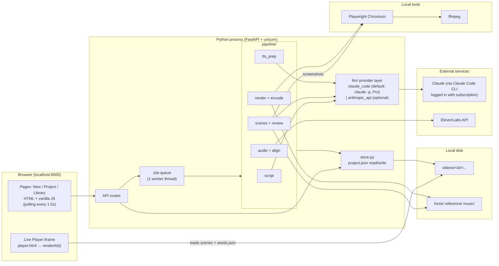
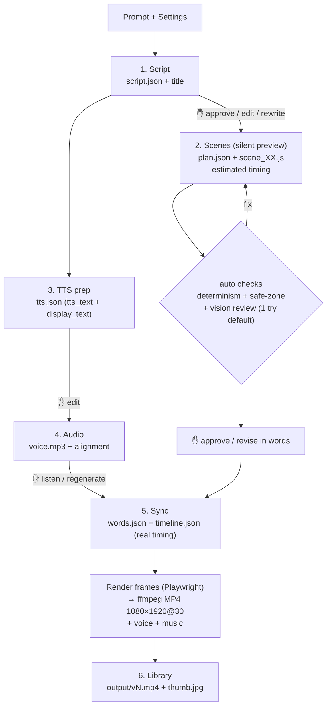
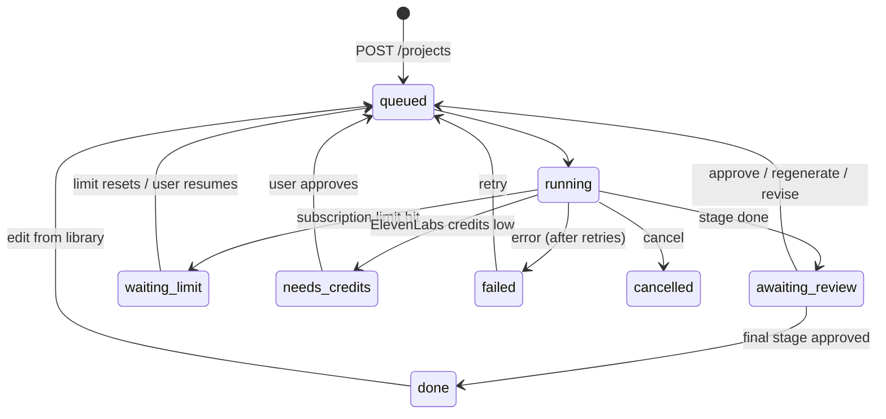

# معمارية تطبيق فيديوهات الموشن جرافيك لتيك توك

> الحالة: **مسودة تصميم بس، ومفيهاش أي كود.** مستنية موافقتك.
> بيئة التشغيل: ماك محلي (`localhost`)، ومستخدم واحد.

## 0. الافتراضات والقرارات المتفق عليها

| البند | القرار |
|---|---|
| الجهاز | Apple Silicon و **رام 8GB**: متصفح واحد، والفريمات بتتبعت مباشرة لـ ffmpeg، والتصدير على دفعات بيكمّل من آخر دفعة لو وقف |
| اللغة | Python 3.12، و HTML/JS بسيط من غير React ومن غير build step |
| Claude | **Claude Pro من غير API key**: المحرك الافتراضي `claude -p` (Claude Code في الخلفية) باشتراكك. طبقة LLM قابلة للتبديل لـ API key من الإعدادات. بنعدّ الطلبات بدل الدولارات |
| ElevenLabs | **اشتراك ElevenLabs**: المفتاح من حسابك في `.env`، والاستهلاك من رصيد الـ credits الشهري |
| ElevenLabs | عرض الـ credits المتوقعة قبل التوليد، والمستخدمة فعلًا بعده |
| المشاهد | SVG و CSS، والحركة كلها بمبدأ `renderAt(t)` الحتمي (deterministic). GSAP مسموح بس بـ timeline واقف (paused) ويتعمله `seek` |
| مراجعة الـ vision | **محاولة واحدة لكل مشهد افتراضيًا** (قابلة للتعديل من 0 لـ 2). لو الفيديو أطول من دقيقتين: لقطة واحدة لكل مشهد |
| الترجمة | أسلوب الكاريوكي: الجملة ظاهرة والكلمة الحالية بتنوّر |
| التشغيل | فيديو واحد في نفس الوقت، والباقي في طابور (queue) |
| النسخ | نحتفظ بآخر 3 نسخ MP4 |
| الواجهة | عربي ومن اليمين للشمال (RTL) |
| حدود الـ MVP | الفيديو لحد **60 ثانية**، والـ 5 دقايق في مرحلة بعدين |

---

## 1. المعمارية (Mermaid)

### 1.1 المكونات



### 1.2 تدفق البيانات ونقط الموافقة



**ملاحظة مهمة: العلاقة بين المراحل شجرة صغيرة، مش خط مستقيم**
- السكريبت هو الأساس، والمشاهد وتجهيز النص الاتنين معتمدين عليه.
- الصوت معتمد على تجهيز النص بس.
- التصدير محتاج المشاهد والصوت مع بعض.
- النتيجة: لو عدّلت المشاهد، **الصوت ما يتعادش**. ولو عدّلت النص، **المشاهد ما تتعادش**، وبيتعاد التزامن والتصدير بس.
- في الواجهة بتمشي على الترتيب الطبيعي (1 → 6)، بس الشغل اللي بيتعاد بيتحسب من الشجرة دي.

---

## 2. التقنيات المقترحة

| الجزء | الاختيار | السبب | البديل الأبسط / الأقوى |
|---|---|---|---|
| السيرفر | **FastAPI + uvicorn** | سهل، وبيقرا ويتأكد من البيانات بـ Pydantic، وبيعرض الملفات بسهولة | **Flask**: أبسط شوية، بس التحقق من البيانات يدوي |
| صفحات HTML | **Jinja2 templates** | صفحات بتتولد من السيرفر، ومن غير build | — |
| تفاعل الواجهة | **Vanilla JS** (`fetch`) | مفيش أدوات بناء ولا مكتبات تتعلمها | **htmx**: أقل JS، بس مفهوم جديد تتعلمه |
| التقدم المباشر | **Polling كل 1.5 ثانية** | أبسط حاجة، وبيستحمل إعادة تحميل الصفحة | **SSE** (مرحلة 4) لو احتجنا سرعة أكتر |
| الطابور | `queue.Queue` + **thread واحد** | فيديو واحد في نفس الوقت، فمش محتاجين Celery ولا Redis | — |
| التخزين | **ملف `project.json` لكل فيديو** | مفيش داتابيز، والمكتبة = قراءة فولدر `videos/` | **SQLite** لو المكتبة كبرت جدًا (مش متوقع) |
| Claude | **طبقة `llm/`**، والافتراضي **Claude Code CLI** (`claude -p`، stream-json) بيتشغّل من Python بـ `subprocess` | باشتراك Pro من غير API key، وبيرجّع JSON منظم، ويقبل الصور، وبيبلّغ عن حد الاستخدام ووقت تجديده | **`anthropic_api`** بـ API key، والتبديل بسطر واحد في `.env` |
| ElevenLabs | مكتبة `elevenlabs` الرسمية | فيها `convert_with_timestamps` و `forced_alignment` جاهزين | `httpx` مباشرة |
| الريندر | **Playwright (Python) + Chromium** | نفس المتصفح بيعمل المعاينة والتصدير، فالنتيجة متطابقة | — |
| الترميز | **ffmpeg** (`brew install ffmpeg`) + `h264_videotoolbox` | ترميز سريع بهاردوير الماك | `libx264` (أبطأ، بس جودته ثابتة) |
| الموسيقى البديلة | **numpy** + `soundfile` | توليد pad هادي مجانًا | — |
| إدارة الحزم | **uv** (أو `pip` + `venv`) | تثبيت سريع وملف واحد للحزم | `pip install -r requirements.txt` |

**الحاجات اللي مش هنستخدمها في الـ MVP:** React، Docker، Celery/Redis، داتابيز، WebSockets.

---

## 3. هيكل الفولدرات

```
id/                              ← الريبو
├── .env                         ← ELEVENLABS_API_KEY بس (Claude بيستخدم تسجيل دخول claude على الماك). مش بيترفع على git
├── .env.example
├── .gitignore                   ← .env, videos/, __pycache__
├── pyproject.toml
├── README.md                    ← طريقة التشغيل: ./run.sh
├── run.sh                       ← uvicorn app.main:app --port 8000 + فتح المتصفح
├── docs/ARCHITECTURE.md
│
├── app/
│   ├── main.py                  ← FastAPI: الصفحات + /api
│   ├── config.py                ← قراءة .env + الإعدادات الافتراضية (الحد الأقصى للتكلفة، الموديلات)
│   ├── models.py                ← Pydantic: VideoSettings, Project, StageState
│   ├── store.py                 ← حفظ وقراءة project.json، وقائمة المكتبة، وتدوير النسخ
│   ├── worker.py                ← الطابور + تشغيل المراحل + الإيقاف عند نقط الموافقة
│   ├── llm/
│   │   ├── base.py              ← الواجهة الموحّدة ask() + الأخطاء (LimitReached…)
│   │   ├── claude_code.py       ← claude -p (الافتراضي، اشتراك Pro)
│   │   └── anthropic_api.py     ← API key (اختياري، بعدين)
│   ├── usage.py                 ← عدّاد الاستخدام (Claude + credits بتاعة ElevenLabs)
│   ├── pipeline/
│   │   ├── stages.py            ← تعريف المراحل والاعتماد بينها (DAG)
│   │   ├── script.py
│   │   ├── scenes.py            ← خطة المشاهد + كود كل مشهد
│   │   ├── checks.py            ← فحص الحتمية + المنطقة الآمنة (من غير AI)
│   │   ├── review.py            ← لقطات + مراجعة بالـ vision (محاولة واحدة افتراضيًا)
│   │   ├── tts_prep.py          ← التشكيل + الـ tags + التحقق من النسختين
│   │   ├── audio.py             ← ElevenLabs
│   │   ├── align.py             ← حروف ← كلمات، والبديل forced alignment
│   │   ├── timeline.py          ← توقيت تقديري / حقيقي للمشاهد
│   │   ├── render.py            ← متصفح واحد: JPEG ← ffmpeg stdin، على دفعات (segments) قابلة للاستكمال
│   │   ├── music.py             ← اختيار من music/ أو توليد pad
│   │   └── encode.py            ← ffmpeg: الدمج + الـ ducking + loudnorm + الصورة المصغرة
│   ├── prompts/                 ← البرومبتات كملفات .md (سهل تعدّلها من غير ما تلمس الكود)
│   │   ├── script.md  scene_plan.md  scene_code.md  review.md  tts_prep.md
│   │   └── style_guide.md       ← ملخص الستايل المستخرج من reference/
│   ├── player/                  ← محرك العرض (نفسه في المعاينة والتصدير)
│   │   ├── player.html          ← 1080×1920، والخطوط محلية بـ @font-face
│   │   ├── player.js            ← renderAt(T) الرئيسية: تختار المشهد وتعمل الانتقالات
│   │   ├── subtitles.js         ← ترجمة الكاريوكي من words.json
│   │   ├── fx.js                ← إضاءة + حبيبات + vignette + حركة كاميرا (كلها حتمية)
│   │   ├── kit.js               ← دوال مساعدة: ease, lerp, seededRandom, cue()
│   │   └── vendor/gsap.min.js
│   └── web/
│       ├── templates/  base.html  new.html  project.html  library.html
│       └── static/     app.css  app.js
│
├── fonts/                       ← ReemKufi-*.ttf, IBMPlexSansArabic-*.ttf (هتحطهم إنت)
├── reference/                   ← الفيديو المرجعي HTML (هتحطه إنت)
├── music/                       ← ملفات MP3 (اسم الملف يبدأ بالإحساس: calm_*.mp3, epic_*.mp3)
├── tests/                       ← اختبارات بسيطة: المحاذاة، الحتمية، المنطقة الآمنة
│
└── videos/                      ← مش بيترفع على git
    └── 2026-10-13_fear-of-failure_a1b2/
        ├── project.json         ← الإعدادات + حالة كل مرحلة + التكلفة + العنوان + السجل
        ├── script.json          ← الجمل [{id, text}] + العنوان المقترح
        ├── scenes/
        │   ├── plan.json        ← [{id, sentence_ids, concept, mood}]
        │   ├── scene_01.js …
        │   └── review/          ← اللقطات + ملاحظات المراجعة
        ├── tts.json             ← tokens + tts_text + display_text
        ├── audio/  voice.mp3  alignment.json  music.wav
        ├── words.json           ← [{i, word, start, end, line}] (توقيت حقيقي)
        ├── timeline.json        ← [{scene_id, start, end}]
        ├── output/  v3.mp4  v2.mp4  v1.mp4  thumb.jpg
        └── logs/run.log
```

---

## 4. عقد المشهد (أهم جزء تقني)

كل مشهد ملف JS بيصدّر object بالشكل ده:

```js
export default {
  id: "scene_02",
  setup(root, kit) { /* بيبني الـ SVG/DOM مرة واحدة */ },
  renderAt(t, ctx) { /* t = الوقت جوه المشهد بالثواني. دالة نقية: نفس t ← نفس الشكل */ }
}
```

- **`ctx.duration`**: مدة المشهد.
- **`ctx.cue("w14")`**: الوقت المحلي لكلمة معينة.
  - كده المشهد بيتربط **بالكلمات، مش بالثواني**.
  - لما التوقيت الحقيقي ييجي من الصوت، المشهد بيتظبط لوحده **من غير ما Claude يكتبه تاني**.
- **`kit.rand(seed)`**: أرقام عشوائية ثابتة. ممنوع استخدام `Math.random`.

### قواعد بيفحصها `checks.py` تلقائيًا قبل الـ vision (من غير تكلفة)

**1. فحص الكود (Static):**
- ممنوع: `Math.random`، `Date`، `performance.now`، `requestAnimationFrame`، `setTimeout`، `animation:`، `transition:`.
- ممنوع أي رابط خارجي `http`.

**2. فحص الحتمية:**
- نعمل `renderAt` لنفس الأوقات بترتيبين مختلفين (عادي وعشوائي).
- نقارن الصور الناتجة بالـ hash، ولازم تكون متطابقة.

**3. فحص المنطقة الآمنة:**
- أي عنصر عليه `data-important` لازم يكون جوه المنطقة الآمنة.
- الحدود: من y=10% لـ y=76%، ومن x=0 لـ x=85%.
- الفحص بيتم بـ `getBoundingClientRect` على 5 أوقات مختلفة.

الحاجات اللي بتشترك فيها كل المشاهد (الإضاءة، الحبيبات، حركة الكاميرا، الترجمة) موجودة في `fx.js` و `subtitles.js`. فـ Claude بيركّز على **محتوى المشهد بس**، وده بيخلّي الستايل ثابت ويقلل التوكنز.

**المعاينة اللايف:**
- صفحة `player.html` بتشغّل `renderAt(currentTime)` جوه المتصفح على طول.
- يعني المعاينة الصامتة **مش محتاجة ريندر MP4**: بتشوفها فورًا، وتقدر تقدّم وترجّع (scrub).
- بعد ما الصوت يجهز، المعاينة نفسها بتشتغل متزامنة مع `<audio>`.

### 4.1 التصدير على جهاز رامه 8GB

- **متصفح Chromium واحد وصفحة واحدة.** مفيش أي تشغيل متوازي.
- **مفيش ملفات PNG:**
  - كل فريم: `renderAt(i/30)`، وبعدها `screenshot(type="jpeg", quality=92)`.
  - البايتات بتتبعت على طول لـ `ffmpeg -f image2pipe` عن طريق stdin.
  - يعني في الرام فريم واحد بس في أي لحظة.
- **دفعات (segments) قابلة للاستكمال:**
  - كل 150 فريم (5 ثواني) بيطلعوا في ملف لوحده: `render/seg_0001.mp4`.
  - **ملف الحالة:** `render/state.json` فيه الدفعات اللي خلصت.
  - **التأكد من الدفعة:** بعد ما تخلص، بنعدّ الفريمات بـ `ffprobe`، وبعدها بس بتتسجل.
  - **لو حصل وقف:** التصدير بيكمّل من أول دفعة ناقصة. أقصى خسارة 5 ثواني من الفيديو.
- **الدمج:** `ffmpeg -f concat -c copy` بيدمج الدفعات من غير ما يعيد الترميز، وبعدها بيضيف الصوت والموسيقى في خطوة أخيرة.
- **تقليل الرام:**
  - المتصفح بيتقفل ويتفتح تاني كل 10 دفعات، علشان الذاكرة ما تتراكمش.
  - ffmpeg بيشتغل بـ `h264_videotoolbox` (هاردوير الماك)، وده خفيف على المعالج والرام.
- **التقدم:**
  - `project.json` فيه "فريم 1200 من 1800"، والوقت المتبقي بيتحسب من متوسط سرعة آخر دفعة.

---

## 5. تجهيز النص والتوقيت

### 5.1 مصدر واحد للحقيقة

`tts.json` بيحتوي على قائمة tokens:

```json
[
  {"type": "tag",  "tts": "[softly]"},
  {"type": "word", "i": 0, "tts": "أَمَّا",    "display": "أما"},
  {"type": "word", "i": 1, "tts": "العُزْلَة...", "display": "العزلة..."},
  {"type": "tag",  "tts": "[pause]"},
  {"type": "word", "i": 2, "tts": "فَحَاجَة",  "display": "فحاجة"},
  {"type": "word", "i": 3, "tts": "تَانْيَة.", "display": "تانية."}
]
```

- **`tts_text`** = كل قيم `tts` ورا بعض بمسافات، وده اللي بيروح ElevenLabs.
- **`display_text`** = كلمات `display` بس، من غير tags ومن غير تشكيل، وده اللي بيظهر كترجمة.
- **ربط التوقيت:**
  - وإحنا بنبني `tts_text` بنسجّل بداية ونهاية كل كلمة بعدد الحروف (char offsets).
  - ElevenLabs بيرجّع توقيت **لكل حرف**.
  - فبنحسب: بداية الكلمة = بداية أول حرف فيها، ونهايتها = نهاية آخر حرف.
  - الـ tags بتتشال من الحساب.
  - النتيجة: **الـ tags مستحيل تبوّظ تزامن الترجمة.**

**لما تعدّل النص بإيدك في الواجهة:**
1. التطبيق يعيد تقسيم النص لـ tokens.
2. يشيل الـ tags والتشكيل، ويقارن الكلمات بالنسخة النظيفة.
3. لو عدد الكلمات أو ترتيبها اتغيّر، يحدّث `display` لوحده.

### 5.2 التحقق التقني من ElevenLabs

> موقع ElevenLabs مكانش متاح من البيئة اللي اشتغلت منها، فراجعت كود الـ SDK الرسمي والـ changelog والمصادر التانية.

| السؤال | اللي لقيته | الدرجة |
|---|---|---|
| أنهي موديل بيدعم الـ audio tags؟ | **Eleven v3** (`eleven_v3`) هو اللي بيدعمها، بصيغة `[whispers]`. وطلع من مرحلة alpha في فبراير 2026 | مؤكد |
| هل v3 بيشتغل مع `with-timestamps`؟ | الـ SDK بيقبل أي `model_id` مع `/v1/text-to-speech/{voice}/with-timestamps`. ومنصات تانية بتقدّم v3 مع توقيت. بس **مالقيتش جملة رسمية صريحة** إن v3 مدعوم في الـ endpoint ده | محتمل، ومحتاج تجربة |
| التوقيت لكل حرف ولا لكل كلمة؟ | لكل حرف (`alignment` + `normalized_alignment`)، وإحنا بنجمّعه لكلمات | مؤكد |
| حد الطلب الواحد | v3 بيقبل نص محدود في الطلب الواحد (آلاف قليلة من الحروف). فيديو دقيقة واحدة (حوالي 1500 حرف بالتشكيل) بيعدّي في طلب واحد | كافي للـ MVP |

**الخطة: أول خطوة في التنفيذ تجربة صغيرة (spike) على حسابك**

1. `eleven_v3` + `with-timestamps` على جملة مصرية مشكّلة فيها tags.
2. نتأكد من 3 حاجات:
   - الطلب نجح.
   - الـ tags ما اتنطقتش بصوت عالي.
   - التوقيت بيغطي الحروف كلها.

**البديل لو التجربة فشلت (بالترتيب):**
1. **ElevenLabs Forced Alignment API** (`/v1/forced-alignment`، موجود في الـ SDK الرسمي):
   - نولّد الصوت بـ v3 العادي من غير timestamps.
   - بعدين نبعت الصوت + `display_text` ونرجع بتوقيت كل كلمة.
   - الميزة إن النص معروف مسبقًا، فالنتيجة أدق من تحويل الكلام لنص.
2. **محاذاة محلية مجانية** على الماك (`mlx-whisper` أو `stable-ts`). أضعف شوية في العامية المصرية، بس من غير تكلفة.

`align.py` بيخبّي الطريقة المستخدمة. الباقي من التطبيق بيقرا `words.json` بس.

---

## 6. حالات المهمة ونقط الموافقة

### 6.1 حالة المشروع



### 6.2 حالة كل مرحلة (في `project.json`)

`pending` → `running` → `review` → `approved`. وفيه كمان حالتين:
- `stale`: اتغيّر حاجة قبلها، فلازم تتعاد.
- `failed`: فشلت، ومعاها رسالة الخطأ.

```json
"stages": {
  "script":  {"status": "approved", "attempts": 1, "claude_calls": 2},
  "scenes":  {"status": "review",   "progress": {"done": 5, "total": 7, "step": "vision review scene 6"}},
  "tts":     {"status": "pending"}, "audio": {"status": "pending"}, "render": {"status": "pending"}
},
"usage": {"claude_calls": 14, "elevenlabs_credits": 1480}
```

### 6.3 عرض التقدم في المهام الطويلة

- الـ worker بيكتب `progress` في `project.json` بعد كل خطوة صغيرة، زي "مشهد 3 من 7" أو "فريم 1200 من 1800".
- الصفحة بتسأل `GET /api/projects/{id}` كل 1.5 ثانية، وبتعرض:
  - شريط المراحل الست، وكل مرحلة بلون حالتها.
  - شريط تقدّم + نص الخطوة الحالية + الوقت المتبقي التقديري. في الريندر الوقت ده بيتحسب من سرعة الفريمات.
  - الاستهلاك لحد دلوقتي: عدد طلبات Claude، و credits ElevenLabs المستخدمة من رصيدك.
  - آخر 20 سطر من `run.log`، في قسم مخفي اسمه "تفاصيل".
- لو قفلت الصفحة ورجعتلها، الحالة كلها في `project.json`، فمفيش حاجة بتضيع.
- لو التطبيق نفسه وقف، أي مرحلة كانت `running` بتتحول لـ `failed` (مع زر "إعادة المحاولة") أول ما يشتغل تاني.

### 6.4 طبقة الـ LLM، والاشتراك، وحدود الاستخدام

**طبقة قابلة للتبديل (`app/llm/`):**
- `base.py` بيحدد واجهة واحدة لكل المراحل:
  `ask(system, prompt, schema, images=[], model) → {data, requests, usage_hint}`
- فيه طريقتين للتنفيذ:
  - `claude_code.py`: **الافتراضي**. بيشغّل `claude -p` باشتراك Claude Pro.
  - `anthropic_api.py`: بيستخدم مكتبة `anthropic` و API key. مش هيتكتب غير لما تحتاجه.
- **الاختيار:** `LLM_PROVIDER=claude_code|anthropic_api` في `.env`، وبيظهر كمان في صفحة الإعدادات.
- المراحل بتنادي `ask()` بس، ومش عارفة مين اللي بينفّذ.

**طريقة الاستدعاء في `claude_code.py`:**

```bash
claude -p \
  --input-format stream-json --output-format stream-json --verbose \
  --json-schema '<شكل الرد>' \
  --system-prompt "<برومبت المرحلة>" \
  --model <من الإعدادات> \
  --tools "" \                      # أو "Read" لو محتاجين يقرا صورة من ملف
  --strict-mcp-config --disable-slash-commands --no-session-persistence \
  --permission-mode dontAsk
# stdin: رسالة JSON واحدة فيها النص + الصور base64 (للمراجعة بالـ vision)
```

**اللي اتأكدنا منه في الدوكيومنتيشن:**
- **JSON منظم:** `--json-schema` بيرجّع الرد في حقل `structured_output`.
- **الصور، بطريقتين:**
  - (أ) رسالة `stream-json` فيها بلوك `image` بصيغة base64.
  - (ب) أداة `Read` على مسار الصورة. الدوكيومنتيشن بتقول إن Claude "بيشوف" الصورة، وإن الصور الكبيرة بتتصغّر.
  - المرحلة 0 بتجرّب الاتنين.
- **حد الاستخدام:**
  - وضع `stream-json` بيطلّع حدث `rate_limit_event` فيه:
    - `status`: `allowed` / `allowed_warning` / `rejected`
    - `resets_at`: وقت التجديد
    - `utilization`: نسبة الاستخدام
    - `rate_limit_type`: `five_hour` / `seven_day` …
  - ده اللي بيخلّينا نعرض **إمتى الحد هيتجدد** بالظبط.
- **`--bare` مش هينفع:** لأنه مش بيقرا تسجيل دخول الاشتراك.
- **الإعدادات المخففة مهمة جدًا مع Pro:**
  - **التجربة:** طلب فاضي بإعدادات Claude Code العادية حمّل حوالي **33,900 توكن**. نفس الطلب بـ `--system-prompt` + `--tools ""` + flags التخفيف نزل لحوالي **1,300 توكن**.
  - **النتيجة:** الحمل الثابت لكل طلب أقل بحوالي 25 مرة، وده بيوفّر كتير من حد الاشتراك.

**التشغيل:**
- بيتعمل في فولدر فاضي (`videos/<id>/.claude_work/`).
- `--system-prompt` بيستبدل برومبت Claude Code الافتراضي، وده بيقلل الاستهلاك.

**شروط الاستخدام** (مراجعة صفحة Legal and compliance الحالية في دوكيومنتيشن Claude Code):
- حسابات Pro/Max خاضعة لـ Consumer Terms. وحدود Pro/Max المعلنة "مفترضة لاستخدام فردي عادي لـ Claude Code والـ Agent SDK".
- الممنوع: إن مطوّر **يقدّم تسجيل دخول claude.ai جوه منتج لمستخدمين تانيين**، أو **يمرّر طلبات تانيين** على اشتراك Pro/Max، أو **يجمع أو يخزّن** بيانات الدخول.
- المسموح صراحةً: إن المستخدم نفسه يسجّل دخول في **Claude Code الأصلي من غير تعديل** باشتراكه.
- **تطبيقنا:**
  - بيشغّل `claude` الأصلي على جهازك، بتسجيل دخولك إنت، علشان استخدامك الشخصي.
  - مش بيلمس ولا بيخزّن أي توكن.
  - ده متوافق مع النص الحالي حسب قرايتي، **بس ده مش رأي قانوني**.
- **الشروط علشان يفضل كده:**
  - التطبيق ما يتوزّعش ولا يتقدّم لحد تاني بالوضع ده. لو حصل، يتحوّل لـ `anthropic_api`.
  - الاستخدام يفضل معقول، وده بيتحقق بإن التطبيق بيعمل طلب واحد في نفس الوقت.

**حد الاستخدام: السلوك في الواجهة**
1. لو حدث `rate_limit_event` رجع بـ `rejected`، أو الطلب فشل بسبب الحد:
   - المرحلة الحالية تتحفظ (كل طلب ناجح متسجّل في ملفه).
   - المشروع يدخل حالة `waiting_limit`، ومعاه `resets_at`.
2. الصفحة تعرض: "متوقف: وصلت لحد Claude (حد الـ 5 ساعات). غالبًا يتجدد الساعة 7:40 م"، وزرار **[كمّل]**.
3. الزرار بيبعت `POST /resume`، وكمان التطبيق بيكمّل لوحده بعد `resets_at` بدقيقتين.
4. لو `allowed_warning`: شريط أصفر "قربت من الحد (85%)".

**عدّاد الطلبات بدل الدولار:**
- كل استدعاء بيتسجّل في `project.json`:
  `usage.claude.by_stage = {"script": 1, "scene_plan": 1, "scene_code": 7, "review": 7, "tts_prep": 1}`
- الواجهة بتعرض: الإجمالي للفيديو، وكل مرحلة لوحدها، وآخر `utilization` معروفة.
- `total_cost_usd` اللي بيرجع من CLI بيتسجل في اللوج بس، كمؤشر داخلي.

**مراجعة الـ vision:** محاولة واحدة لكل مشهد افتراضيًا (`VISION_REVIEW_ATTEMPTS=1`)، وتقدر تغيّرها من الإعدادات (0 = مفيش مراجعة).

**رصيد ElevenLabs:**
- **قبل التوليد:**
  - التقدير = عدد حروف `tts_text`.
  - الواجهة تعرض: "هيستهلك حوالي 1,430 credit، والمتبقي 21,300".
- **بعد التوليد:**
  - المستهلك فعلًا = الفرق في `character_count` من `GET /v1/user/subscription` قبل الطلب وبعده.
  - الرقمين بيتسجلوا في `usage.elevenlabs = {"expected": 1430, "actual": 1418}`.
- لو الرصيد هيقل عن 20% بعد التوليد، المشروع يدخل حالة `needs_credits` ويسألك الأول.

**تجهيز الماك (مرة واحدة):**
1. تسطيب Claude Code.
2. تشغيل `claude` وتسجيل الدخول بحساب Pro.
- `/api/usage` بيتأكد إن `claude` متسطّب ومسجّل دخول.

---

## 7. الـ API Endpoints

| Method | Path | الوظيفة |
|---|---|---|
| GET | `/` ، `/new` ، `/p/{id}` ، `/library` | الصفحات |
| GET | `/api/voices` | أصواتك من ElevenLabs (متخزّنة في الذاكرة ساعة) |
| GET | `/api/music` | قائمة ملفات `music/` |
| POST | `/api/projects` | مشروع جديد `{prompt, settings}` ← `{id}` |
| GET | `/api/projects` | المكتبة (عنوان، صورة مصغرة، تاريخ، مدة، حالة) |
| GET | `/api/projects/{id}` | الحالة الكاملة (بيستخدمها الـ polling) |
| PATCH | `/api/projects/{id}` | تغيير العنوان |
| DELETE | `/api/projects/{id}` | مسح الفولدر (التأكيد بيحصل في الواجهة) |
| GET | `/api/projects/{id}/stages/{stage}` | محتوى المرحلة (السكريبت، النص المجهّز…) |
| PUT | `/api/projects/{id}/stages/{stage}` | حفظ تعديلك اليدوي، والمراحل اللي بعدها تتعلّم `stale` |
| POST | `/api/projects/{id}/stages/{stage}/approve` | موافقة ← المرحلة اللي بعدها تدخل الطابور |
| POST | `/api/projects/{id}/stages/{stage}/regenerate` | إعادة توليد، مع `{instruction?}` اختياري |
| POST | `/api/projects/{id}/stages/scenes/revise` | `{instruction, scene_id?}`، زي "خلي المشهد التاني أهدى" |
| POST | `/api/projects/{id}/edit` | `{from_stage}`: الرجوع لمرحلة من المكتبة |
| POST | `/api/projects/{id}/resume` | استكمال بعد حد الاستخدام أو بعد الموافقة على الـ credits |
| GET | `/api/usage` | رصيد ElevenLabs المتبقي + حالة Claude CLI (مسجّل دخول ولا لأ) |
| POST | `/api/projects/{id}/cancel` | إلغاء المهمة الحالية |
| GET | `/player/{id}?mode=preview\|final` | صفحة المشغّل (iframe) |
| GET | `/files/{id}/{path}` | الملفات (MP4 مع Range علشان التقديم والترجيع، وتحميل بـ `?download=1`) |

---

## 8. شاشات الواجهة

### 8.1 فيديو جديد (`/new`)
```
┌───────────────────────────────────────────┐
│  [المكتبة]                    فيديو جديد  │
├───────────────────────────────────────────┤
│  فكرة الفيديو:                            │
│  ┌─────────────────────────────────────┐  │
│  │ فيديو عن الخوف من الفشل            │  │
│  └─────────────────────────────────────┘  │
│  المدة   [10ث ●────────── 60ث]   30 ثانية │
│  اللهجة  (●) مصري  ( ) فصحى               │
│  الصوت   [▼ صوت أحمد ]  [▶ سماع عينة]     │
│  الإحساس [▼ تحفيزي ]                      │
│  الموسيقى [✓]  مستوى ──●──  [▼ تلقائي]    │
│  الترجمة [✓]                              │
│  ▸ إعدادات متقدمة                         │
│  ElevenLabs: ~1,500 credit (متبقي 21,300) │
│                         [ ابدأ ▶ ]        │
└───────────────────────────────────────────┘
```

**إعدادات إضافية مقترحة** (تحت "متقدمة"، وكلها ليها قيم افتراضية):
- **سرعة الكلام:** بطيء / عادي / سريع. بتأثر على عدد كلمات السكريبت.
- **نوع الافتتاحية (Hook):** سؤال، رقم صادم، أو جملة قوية. أول ثانيتين أهم حاجة في تيك توك.
- **الجمهور:** شباب، طلبة، موظفين… بيغيّر الأمثلة في السكريبت.
- **باليتة الألوان:** دافئة، باردة، ليلية، أو تلقائي حسب الإحساس.
- **إيقاع الحركة:** هادي ↔ ديناميكي.
- **حجم الترجمة:** صغير / متوسط / كبير.
- **قوة الحبيبات والإضاءة:** من 0 لـ 100.
- **ثبات الصوت:** stability في ElevenLabs.
- **محاولات مراجعة الـ vision:** 0 أو 1 (الافتراضي) أو 2.
- **محرك الـ LLM:** Claude Code (اشتراك) أو API key، والموديل لكل مرحلة.

### 8.2 صفحة المشروع (`/p/{id}`)
```
┌───────────────────────────────────────────────┐
│ "مش لازم تنجح من أول مرة" ✎   1,480 credit │
│ ①سكريبت✓ ②مشاهد● ③نص ④صوت ⑤تصدير ⑥تم        │
├──────────────────────┬────────────────────────┤
│   محتوى المرحلة      │   ┌──────────┐         │
│  (حسب المرحلة الحالية)│   │  مشغّل   │ 9:16    │
│                      │   │  لايف    │         │
│ ███████░░ مشهد 5/7   │   └──────────┘         │
│ "مراجعة بصرية..."    │   ◀ ▶ ──●──── 0:12     │
├──────────────────────┴────────────────────────┤
│ [✓ موافق]  [↻ أعد التوليد]  [✎ اطلب تعديل: ___]│
└───────────────────────────────────────────────┘
```

محتوى العمود الأيمن بيتغيّر حسب المرحلة:
- **السكريبت:** textarea قابل للتعديل + عدد الكلمات والمدة التقديرية.
- **المشاهد:** قائمة المشاهد، وكل مشهد معاه صورة مصغرة + ملاحظات المراجعة + زر "عدّل المشهد ده".
- **النص:** محرّر للـ `tts_text`، والـ tags ملونة بلون مختلف، وتحته معاينة `display_text`.
- **الصوت:** مشغّل صوت + زر "أعد التوليد" + اختيار seed.
- **التصدير:** شريط الفريمات + الوقت المتبقي.

### 8.3 المكتبة (`/library`)
```
┌──────────────────────────────────────────────┐
│ المكتبة                    [+ فيديو جديد]    │
│ ┌──────┐ ┌──────┐ ┌──────┐                   │
│ │thumb │ │thumb │ │ ⏳   │                   │
│ │0:45  │ │0:30  │ │مشاهد │                   │
│ └──────┘ └──────┘ └──────┘                   │
│ عنوان ✎  عنوان ✎  (جاري)                     │
│ 13 أكتوبر                                    │
│ [▶ عرض][⬇ MP4][✎ تعديل▾][🗑]                 │
└──────────────────────────────────────────────┘
```

- **عرض:** نافذة منبثقة (modal) فيها `<video>`.
- **تعديل ▾:** قائمة فيها: السكريبت / المشاهد / النص / الصوت.
- **مسح:** رسالة تأكيد فيها اسم الفيديو.
- **النسخ:** لو فيه نسخ قديمة، بتظهر قائمة صغيرة: v3 / v2 / v1.

---

## 9. الاستهلاك والوقت التقريبي

### 9.1 Claude (اشتراك)
- **مفيش تكلفة لكل فيديو.** اللي بيهمك هو **حد الاستخدام**.
- اشتراكك **Pro**، وده أقل حد بين الخطط. التقدير المبدئي إن فيديو دقيقة واحد ممكن ياخد جزء كبير من حد الـ 5 ساعات، والمرحلة 0 هتقيس الرقم الحقيقي.
- عدد طلبات Claude لكل فيديو بيبيّن الفرق بين المدد:
  - **السكريبت:** طلب واحد، والعنوان بيطلع معاه.
  - **خطة المشاهد:** طلب واحد.
  - **كود المشاهد:** طلب لكل مشهد.
  - **المراجعة والإصلاح:** طلب لكل محاولة.
  - **تجهيز النص:** طلب واحد.

### 9.2 ElevenLabs (اشتراك)
- الـ credits تقريبًا = عدد الحروف، و**التشكيل بيتحسب حروف**.
- كل مرة تعيد توليد الصوت بتتحسب تاني.

### 9.3 جدول التقدير

| | 10 ثواني | 60 ثانية (حد الـ MVP) | 5 دقايق (مرحلة 3) |
|---|---|---|---|
| عدد الكلمات تقريبًا | 25 | 140 | 700 |
| عدد المشاهد | 2–3 | 6–9 | 30–40 |
| طلبات Claude (من غير إعادة) | 6–10 | 15–30 | 70–90 |
| ما يعادل الاستهلاك بأسعار الـ API (للمقارنة بس) | ~$0.3 | ~$1–1.6 | ~$4–6.5 |
| ElevenLabs (credits) | ~300 | ~1,500 | ~7,500 |
| وقت توليد AI | 2–4 دقايق | 6–12 دقيقة | 30–50 دقيقة |
| وقت الريندر على 8GB (متصفح واحد) | 30–60 ثانية | 3–6 دقايق | 15–30 دقيقة |

**الخلاصة:**
- **ElevenLabs هو الحد الحقيقي لعدد الفيديوهات في الشهر:**
  - عدد الفيديوهات تقريبًا = رصيدك الشهري ÷ 1,500 (لفيديو الدقيقة)، وأقل من كده لو بتعيد توليد الصوت.
  - مثال: لو رصيدك 30,000 credit، ده حوالي 15–20 فيديو دقيقة في الشهر، أو 4 فيديوهات بس من الـ 5 دقايق.
- **Claude:** فيديو الـ 5 دقايق تقيل على حد الاشتراك، فممكن يقف في النص ويكمّل بعد ما الحد يتجدد. في المرحلة 3 ممكن نستخدم `--model sonnet` لكتابة المشاهد علشان نخفف الاستهلاك.
- الوقت أطول شوية من الـ API، لأن كل استدعاء لـ `claude -p` بياخد ثواني علشان يبدأ.
- كل الأرقام تقديرية، والعدّاد في `usage.py` هيبيّن الأرقام الحقيقية بعد أول كام فيديو.

---

## 10. المخاطر ونقط الفشل المتوقعة

| المخاطرة | الأثر | التعامل معاها |
|---|---|---|
| v3 مش مدعوم مع `with-timestamps`، أو التوقيت فيه مشكلة مع التشكيل | الترجمة مش متزامنة | تجربة في المرحلة 0، والبديل جاهز في `align.py`: Forced Alignment، وبعده المحاذاة المحلية |
| الـ tags بتتنطق بصوت عالي، أو بتتجاهل | الصوت غلط | قائمة tags مسموحة بس (whitelist)، وحد أقصى tag لكل جملتين. وفي الواجهة: زر "شيل كل الـ tags" |
| نطق غلط رغم التشكيل | جودة الصوت | تعدّل الكلمة في محرر النص، وتعيد توليد الجملة دي بس (مرحلة 4)، أو قاموس نطق ثابت `pronunciations.json` |
| مشهد مش حتمي (بيستخدم الوقت الحقيقي أو `Math.random`) | فريمات بتترعش أو بتختلف | الفحص الآلي في `checks.py` قبل أي حاجة، والمشهد بيرجع لـ Claude ومعاه الخطأ بالظبط |
| كود المشهد فيه خطأ JS | المشهد فاضي | Playwright بيلقط أخطاء الـ console ويبعتها لـ Claude في محاولة الإصلاح، ولو فشل: مشهد احتياطي بسيط (عنوان + خلفية متحركة) |
| كلام مهم برّه المنطقة الآمنة | يتغطّى بأزرار تيك توك | فحص آلي بـ `getBoundingClientRect` + ملاحظة في برومبت الـ vision. وفي المعاينة: overlay بيبيّن المنطقة الآمنة |
| الخط العربي مش محمّل قبل اللقطة | خط غلط في الفريمات | `await document.fonts.ready` قبل أول فريم، والخطوط من `fonts/` بس |
| الحروف العربية بتتقطع أو مقلوبة في SVG | النص مقروء غلط | الأفضل استخدام عناصر HTML للنص بدل `<text>` في SVG، و `dir="rtl"`، ونفحص ده في المراجعة |
| حلقة المراجعة بتستهلك حد الاشتراك | الفيديو بيقف | محاولة واحدة افتراضيًا + حالة `waiting_limit` بوقت التجديد + زرار كمّل |
| رام 8GB بتخلص (Chromium + ffmpeg + Claude Code) | بطء شديد أو التطبيق يقع | متصفح واحد، و JPEG مباشرة لـ ffmpeg، وطلب Claude واحد في نفس الوقت (الـ worker واحد فطبيعي إن الريندر و Claude ما يشتغلوش مع بعض)، وإعادة تشغيل المتصفح كل دفعة، ونصيحة في الواجهة تقفل التطبيقات التقيلة وقت التصدير |
| `claude -p` مش مسجّل دخول، أو اتحدّث وغيّر شكل الـ JSON | المراحل كلها بتفشل | فحص عند تشغيل التطبيق + رسالة واضحة في الواجهة + `claude_cli.py` هو المكان الوحيد اللي بيقرا الرد |
| رصيد ElevenLabs يخلص في نص الشهر | مفيش صوت | عرض الرصيد في الواجهة + `needs_credits` + إعادة توليد جملة واحدة بدل الصوت كله (مرحلة 2) |
| مشاكل في الـ API (rate limit / 5xx / timeout) | المرحلة بتفشل | إعادة المحاولة التلقائية في الـ SDK + حالة `failed` واضحة + زر إعادة المحاولة. وأي حاجة اتعملت قبل كده محفوظة |
| التطبيق وقف في نص الريندر | ضياع شغل | كل مرحلة بتكتب ملفاتها في الآخر بس (كتابة لملف مؤقت وبعدين rename)، والريندر بيبدأ من الأول (دقايق قليلة) |
| المساحة على الهارد | الامتلاء | الفريمات بتروح مباشرة لـ ffmpeg من غير ما تتحفظ PNG، والنسخ بحد أقصى 3، والتخزين المتوقع حوالي 30–80MB للفيديو |
| مفتاح الـ API يتسرّب | أمان | المفاتيح في `.env` بس، و `.gitignore`، والسيرفر على `127.0.0.1` بس، والمفاتيح مش بتتبعت للواجهة أبدًا |
| إن Claude يكرر نفس الشكل في كل الفيديوهات | ملل | خطة المشاهد بتطلب "استعارة بصرية خاصة بالموضوع"، وبنبعت قائمة بالمفاهيم اللي اتعملت في آخر 5 فيديوهات علشان يتجنبها |
| الموسيقى صوتها عالي فوق الكلام | وضوح الكلام | ducking بـ `sidechaincompress` + `loudnorm` على -14 LUFS |

---

## 11. خطة التنفيذ على مراحل

### المرحلة 0: تجارب التحقق (يوم أو اتنين)
- **تجربة Claude CLI:**
  - `claude -p` بـ `--json-schema` (JSON منظم).
  - صورة بطريقتين: أداة `Read`، و base64 في `stream-json`.
  - الموديلات المتاحة على Pro، وحدث `rate_limit_event`.
  - نقيس الوقت لكل طلب.
- **تجربة ElevenLabs:**
  - `eleven_v3` + `with-timestamps` + جملة مصرية مشكّلة فيها tags.
  - نشوف: هل الطلب نجح؟ وهل الـ tags اتنطقت؟ وهل التوقيت دقيق؟
- **تجربة الريندر:**
  - Playwright على `reference/`: نعمل `renderAt(i/30)` لـ 300 فريم بمقاس 1080×1920، و JPEG مباشرة لـ ffmpeg على دفعتين، وبعدين ندمجهم.
  - نقيس السرعة والرام على جهازك، ونتأكد إن الحتمية شغالة والخطوط محمّلة.
- **قرار:** نختار طريقة التوقيت، ونتأكد من تقدير وقت الريندر.

### المرحلة 1: الـ MVP (فيديو لحد 60 ثانية، من البداية للنهاية)
- `.env` + `run.sh` + FastAPI + 3 صفحات بسيطة (جديد / مشروع / مكتبة).
- **السكريبت:** التوليد + التعديل + إعادة الكتابة + العنوان التلقائي.
- **المشاهد:**
  - خطة + كود لكل مشهد.
  - الفحوص الآلية (الحتمية + المنطقة الآمنة).
  - معاينة لايف.
  - "اطلب تعديل" بكلام عادي.
- **تجهيز النص:** التشكيل + الـ tags + محرّر.
- **الصوت + التوقيت:** بالطريقة اللي نجحت في المرحلة 0.
- **التزامن والتصدير:** MP4 بمقاس 1080×1920 و30 فريم في الثانية + الصوت + موسيقى من `music/`.
- **المكتبة:** عرض، تنزيل، تغيير العنوان، مسح مع تأكيد.
- **عدّاد الاستهلاك** + التعامل مع حدود الاشتراك + الطابور + polling.
- **مش موجود في المرحلة دي:** مراجعة الـ vision، والتعديل من المكتبة، والنسخ.

### المرحلة 2: الجودة والتعديل
- **مراجعة الـ vision:** لقطات من كل مشهد، و Claude يصلّح. محاولة واحدة افتراضيًا، وقابلة للتعديل من الإعدادات.
- **"تعديل" من المكتبة:** الرجوع لأي مرحلة، والتطبيق يعيد بس اللي محتاج يتعاد (حسب شجرة الاعتماد).
- **النسخ:** آخر 3 نسخ v1/v2/v3.
- **الموسيقى:** توليد pad بـ numpy لو `music/` فاضي، و ducking للموسيقى تحت الكلام.
- **الإعدادات المتقدمة:** الـ hook، والباليتة، والإيقاع، وحجم الترجمة.
- **الـ tags:** قاموس النطق + الـ whitelist.

### المرحلة 3: فيديوهات لحد 5 دقايق
- **تقسيم الصوت:** طلبات على أجزاء مع `previous_text`/`next_text` علشان الإحساس يفضل متصل، ودمج التوقيت.
- **المشاهد:** على دفعات (مثلًا 5 مشاهد في كل طلب) علشان نقلل عدد الطلبات، ومراجعة الـ vision بلقطة واحدة لكل مشهد.
- **الريندر:** نفس المتصفح الواحد (مناسب لـ 8GB). فيديو 5 دقايق = 30 دفعة، وأي دفعة بتكمّل من مكانها لو حصل وقف.
- **الاستهلاك:** اختيار الموديل لكل مرحلة (مثلًا Sonnet لكود المشاهد)، وتقسيم الفيديو الطويل على أكتر من فترة 5 ساعات لو لزم.

### المرحلة 4: تحسينات اختيارية
- SSE بدل الـ polling.
- اختيار الصورة المصغرة من أي فريم.
- قوالب إعدادات محفوظة (Presets).
- ضبط التقدير الزمني تلقائيًا من بيانات صوتك الحقيقية.
- لوجو أو CTA اختياري.
